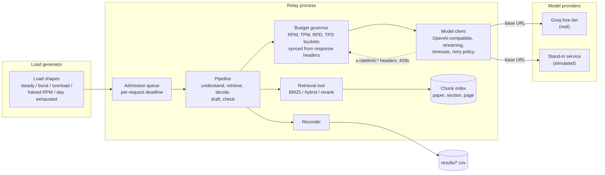
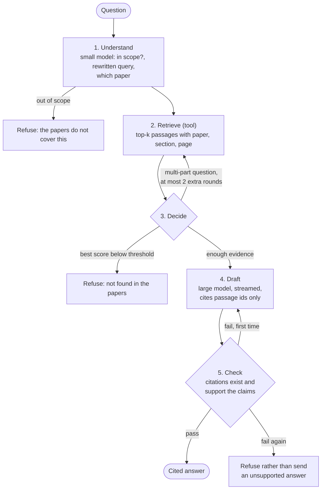

# The Relay

A question-answering pipeline over three arXiv papers that cites every claim, refuses when the papers do not say, and keeps doing both when the model provider is slow, failing, or out of budget.

The library, at pinned versions:

- `1706.03762v7` Attention Is All You Need
- `2410.00037v1` Moshi: a speech-text foundation model for real-time dialogue
- `2507.07955v2` Dynamic Chunking for End-to-End Hierarchical Sequence Modeling

## Architecture

### Components



- **Model client** speaks the OpenAI-compatible chat completions API with streaming. Groq and the stand-in serve the same protocol, so switching between them is a base URL change and nothing else in the pipeline knows which one it is talking to.
- **Budget governor** is one shared instance per process, because the account's daily limit is shared by everything that runs. It holds local token buckets for every limit and corrects them from the `x-ratelimit-*` headers on each response, since the limits can change without notice.
- **Admission queue** gives each request a deadline (the point where the person gives up). A request whose estimated wait already exceeds its deadline is answered immediately with a degraded reply instead of waiting to time out.
- **Retrieval tool** runs locally and costs no model tokens. It is called through the same timeout wrapper as any other tool.
- **Recorder** writes one row per request in the `results.csv` schema from the brief, with timings split into waiting, working and retrying.

### Request flow



The branch and loop the brief asks for are the decide step (refuse, retrieve again, or draft) and the check step (redraft once, then refuse).

### The decision that shapes everything: hold the draft until it passes the check

Nothing reaches the person until the draft has passed the check. The draft is generated in full and buffered, checked for grounded citations, and only then streamed out. "First token" in every table means the first token the person sees, which is after the check.

- **Gives up:** time to first token. It becomes roughly draft time plus check time instead of the model's own first-token latency.
- **Gets:** no unchecked text is ever shown, so there is nothing to retract. A wrong or embarrassing answer costs more than a slow one.
- **Consequence for load:** every request holds its slot for the full draft and check, so concurrency limits and deadlines are set on total time, not first-token time.

### Degradation ladder

When the governor says a step cannot be afforded in time, the pipeline steps down instead of queueing until the person gives up:

1. **Full:** large model drafts, small model checks.
2. **Lean:** fewer passages, small model drafts, deterministic citation check only.
3. **Extractive:** no model call; return the best matching passages verbatim with their citations and say that a written answer is unavailable right now.
4. **Honest no:** budget is gone; say so, say when it resets, and do not guess.

A wrong answer is never on the ladder. Losing speed or fluency is acceptable; losing correctness is not.

### Repository layout

```
src/relay/
  library.py      parse PDFs, split into cited pieces
  retrieval.py    BM25, hybrid with local embeddings, rerank
  client.py       streaming model client, timeouts, retries
  governor.py     rate and budget buckets, header sync
  pipeline.py     the five steps, branches and ladder
  standin.py      stand-in model service
  load.py         load shapes and the results recorder
  tables.py       every write-up table, computed from results.csv
data/papers/      the three PDFs at pinned versions
data/questions/   evaluation questions with expected answers
results/          raw results, one directory per run, never edited
docs/             the two-page write-up and conversation history
tests/
```

## Tests

The tests were written before the code and define each layer's contract. Thresholds live in `tests/thresholds.py`; the gold questions in `data/questions/eval.jsonl`.

- **Gold set** (`tests/test_gold_questions.py`): 36 questions (25 answerable, 5 the papers do not answer, 3 out of scope, 3 prompt injections). Every evidence phrase must exist verbatim in its paper and fit inside one piece at every piece size.
- **Metrics** (`tests/unit/`): precision@k, recall@k, MRR, percentiles, groundedness, answer grading and every write-up table, checked on hand-built inputs.
- **Retrieval** (`tests/retrieval/`): recall@k, MRR and precision@k of the default setting on the gold set, search latency, and behaviour such as never returning reference lists.
- **Generation** (`tests/generation/`, `-m real`): groundedness of every sent answer, correct rate, wrong rate, refusal of unanswerable questions, over-refusal.
- **Application** (`tests/application/`): out-of-scope and injection handling against Groq (`-m real`), and pipeline guarantees against the stand-in: unchecked drafts are never sent, first token only after the check, bounded loops, retries, deadlines, daily budget exhaustion.
- **System** (`tests/system/`, `slow`): every load shape against the stand-in, and the submitted `results/results.csv` against the brief's schema.

```sh
uv run pytest                 # everything except Groq calls
uv run pytest -m real         # spends the Groq daily budget
RELAY_EVAL_REPLIES=results/<run>/replies.jsonl uv run pytest -m real   # regrade saved replies for free
```

## Setup

```sh
uv sync
cp .env.example .env   # add your GROQ_API_KEY
```

## Contributing

See [CONTRIBUTING.md](CONTRIBUTING.md).
